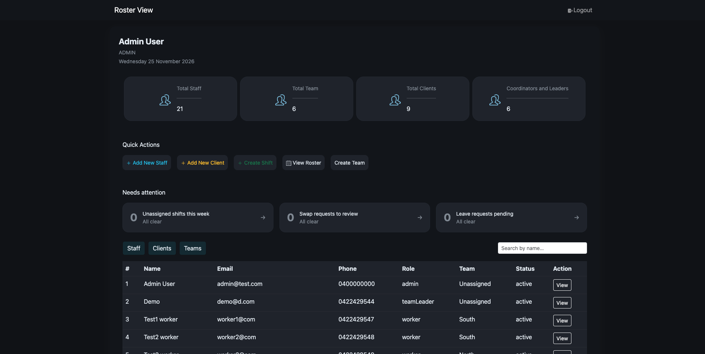
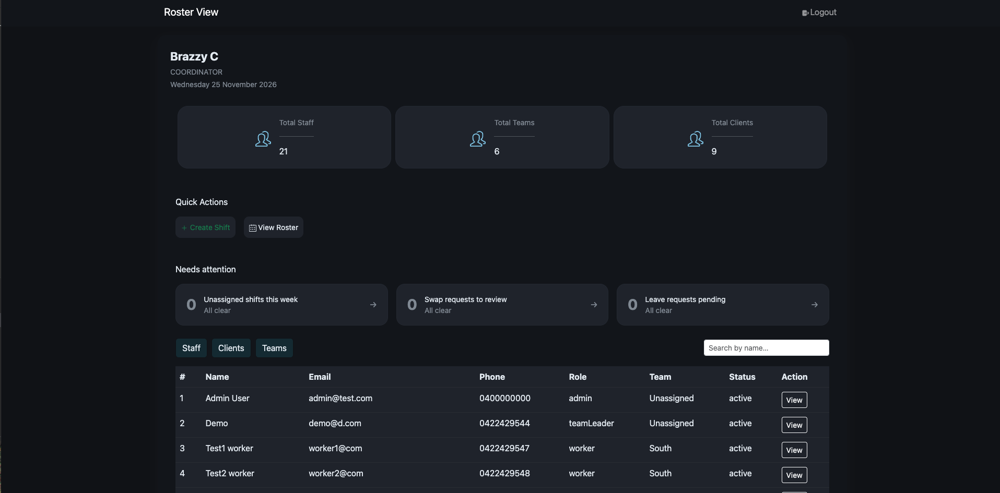
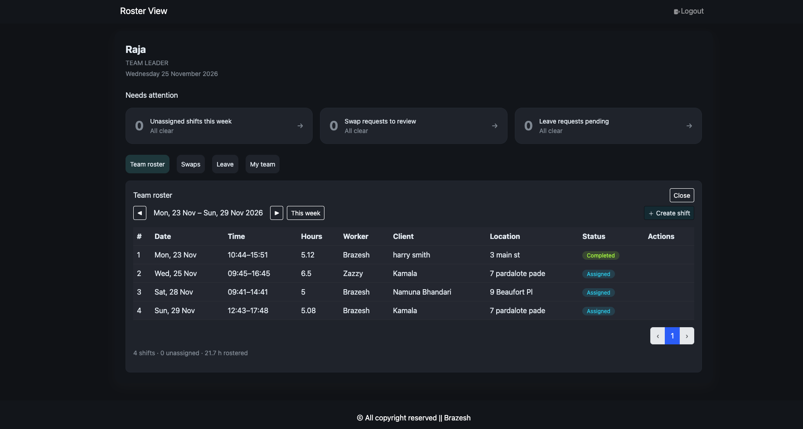
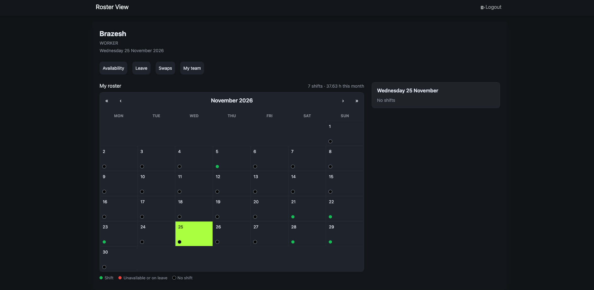

# RosterView — Frontend

A rostering app for support-work teams: managers build the weekly roster,
assign workers to clients, and handle shift swaps and leave; workers see their
shifts, set availability and request swaps or leave.

This is the React frontend. The API lives in
[RosterView-backend](https://github.com/bguragain1023-web/RosterView-backend).



## Features by role

**Admin**

- Dashboard with staff, team and client counts and a "Needs attention" panel
  (unassigned shifts this week, swaps to review, pending leave)
- Add and edit staff, clients and teams; set roles and extra permissions
- Full roster: create, edit, assign, cancel and reinstate shifts
- Searchable, paginated tables for staff, clients and teams

**Coordinator**

- Same roster and review tools as admin, across every area
- Read-only staff and team detail pages

**Team leader**

- Runs their team's area: create, assign, edit and cancel shifts for their
  area's clients
- Reviews swap and leave requests from their team

**Worker**

- Monthly roster calendar with their shifts
- Weekly and date-specific availability
- Requests shift swaps with teammates and applies for leave

**Everyone**

- Login with role-based routing; new staff must change their temporary
  password on first login

## Key rules (enforced by the backend, reflected in the UI)

- **Teams are areas.** Every client belongs to a team; only workers in that
  team can be assigned to the client's shifts.
- **Swaps** are between teammates, in the same Monday–Sunday week, and need
  the colleague's acceptance and then a manager's approval.
- **Leave** that is approved unassigns the worker from shifts in that period.
- Past assigned shifts are marked **completed** automatically.

## Tech stack

- React 19 + TypeScript, built with Vite
- React Router 7 (role-protected routes)
- React Bootstrap / Bootstrap 5, react-icons
- Axios for API calls, react-toastify for notifications
- react-calendar for the worker roster view

## Getting started

Requirements: Node 20+ and the [backend](https://github.com/bguragain1023-web/RosterView-backend)
running locally.

```bash
git clone https://github.com/bguragain1023-web/Rosterview-Frontend.git
cd Rosterview-Frontend
yarn install
```

Create a `.env` file in the project root:

```bash
VITE_ROOT_API=http://localhost:8000
```

Then start the dev server:

```bash
yarn dev
```

Open http://localhost:5173 and log in with a user created by the backend's
seed script.

## Scripts

| Command        | What it does                        |
| -------------- | ----------------------------------- |
| `yarn dev`     | Start the dev server                |
| `yarn build`   | Type-check and build for production |
| `yarn preview` | Serve the production build locally  |
| `yarn lint`    | Run ESLint                          |

## Project structure

```
src/
  pages/        one file per screen (Admin, Coordinator, TeamLeader, Worker, …)
  components/   forms, tables, modals and role-specific panels
  helper/       axios.ts – every API call and its types
  contex/       UserContext – the logged-in user
  utils/        date and formatting helpers
```

## Screenshots

| Coordinator                                                | Team leader                                                | Worker                                                          |
| ---------------------------------------------------------- | ---------------------------------------------------------- | --------------------------------------------------------------- |
|  |  |  |

## Author

Built by [Brazesh Guragain](https://www.brazeshguragain.com).
